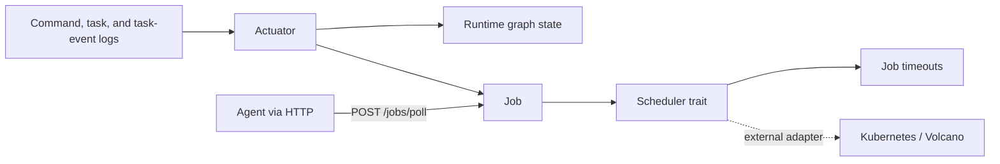
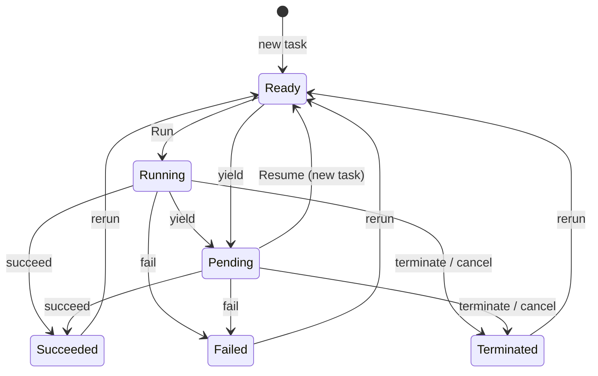

# Architecture

Rayflow is a DAG-based task runtime. A graph describes nodes and directed edges;
a run persists the execution state of those nodes. Commands, logical tasks, and
task events are append-only records. Consumers apply those records to durable
runtime state and create executable jobs.

The workspace contains five core crates and three binaries:

- `event` defines backend-independent event, emit, read, poll, and reactive-consumer contracts.
- `graph` defines graph primitives, validation, and the versioned graph store.
- `coordinator` provides MySQL-backed leader election.
- `runtime` applies commands and owns run and node-run state.
- `scheduler` actuates tasks into jobs and abstracts scheduling destinations.
- `server` exposes the HTTP API.
- `pilot` consumes logs while holding the leader lease.
- `agent` polls for jobs, executes containers, and reports results.

## Control Flow

1. The server accepts a run command and appends a `CommandEntry`.
2. The pilot acquires or renews the coordinator lease.
3. The pilot consumes commands and applies them through `runtime::Backend`.
4. Command application creates or advances node runs and emits logical `Task` records.
5. The scheduler actuator converts tasks into `Job` records and activates ready nodes.
6. An agent polls for resource-fitting jobs, executes them, and reports a task event.
7. The pilot consumes the task event, settles the job, and applies the resulting command.
8. Effects and log acknowledgements commit in the same transaction where possible.

The pilot serializes global log consumption. Standby pilots do no work until the
current leader's lease expires or is released.

## State Machine

A task is emitted when a node is created or transitions to `Ready`. The actuator
activates a ready task as `Running` without emitting another task.

`Pending` is a deferral. `Resume` creates a fresh task in the same node run and
revision; the old job remains terminal as `Yielded`. `Rerun` advances the node
revision. `Dryrun` mocks upstream success so selected nodes can be prepared.

## Persistence Boundaries

The database stores graph versions, runs, node runs, configurations, jobs, and
the three append-only logs. Toasty models are the source of truth; `rayflow.sql`
mirrors the model schema for direct provisioning.

Transactions cover command effects and acknowledgements, actuator task/job
materialization, task-event handling, and pilot timeout handling. External
schedulers must submit committed requests and reconcile submissions after an
uncertain response or rollback.
